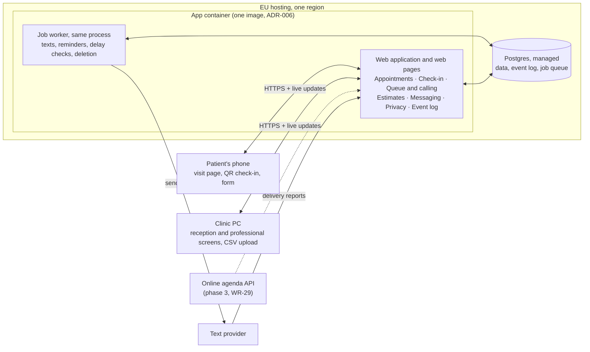

# Clinic Waiting Room Architecture Document

One web application with a Postgres database, hosted in the EU, serves both the patients' visit pages and the staff screens. It ships as one container image and runs as one container next to the database (ADR-006). Every check-in and call is written as an event; queue order, estimates and texts are all computed from those events. The scale is small (one clinic), so the design favors simple, cheap and easy to audit over anything distributed.

## At a glance



Browsers talk only to the web application, which also keeps their screens updated live. The job worker runs in the same process and container, shares the same database and sends the texts; the provider reports delivery back to the application. To deploy, run the one app container against a managed Postgres; to scale, run more copies of it.

## Assumptions and constraints

From the PRD and backlog:

- **Scale:** one clinic with a few professionals. The design assumes under 500 appointments a day, so a single server is enough.
- **Regulation:** Belgium, under the GDPR. A reason for visit is health data, so all data stays in the EU and access to form answers is logged.
- **Devices:** professionals use a browser on the clinic PC; patients use their phone's browser. Nothing is installed.
- **Appointments:** loaded from a CSV file for the demo and v1; the online agenda's API replaces the file later (WR-29).
- **Not safety-critical:** professionals still call patients aloud. If the service is down, the clinic works as it does today, so one server with daily backups is acceptable.

Not stated anywhere, so assumed here (please correct):

- **Team:** confirmed as one senior developer working with Claude Code agents; no stack fixed yet. One codebase, one language and the backlog's testable acceptance criteria suit this setup: each story can be handed to an agent and checked against its criteria.
- **Stack:** confirmed: TypeScript on server and browser, React for the patient pages and staff screens, Postgres for data. One language end to end.

## Components

One deployable application split into modules with clear boundaries. The background worker is part of the same process, so one container runs the whole application (ADR-006).

| Component | What it owns | Backlog stories |
| --- | --- | --- |
| Patient pages | Visit page, QR check-in, pre-visit form, estimate display | WR-02, WR-05, WR-07, WR-08, WR-17, WR-18 |
| Staff screens | Reception and professional screens: import, check-in, queue, call buttons, flags | WR-01, WR-06, WR-09 to WR-16 |
| Appointments module | CSV import, validation, duplicate detection; one interface so the agenda API can replace the file | WR-01, WR-29 |
| Visits and check-in module | Visit links, recognized phones, text codes, walk-ins | WR-02, WR-07 to WR-10 |
| Queue and calling module | Order rule, emergency flag, next / out-of-order / skip | WR-12 to WR-16 |
| Estimates module | Lateness, estimate ranges and slip reasons, computed from events | WR-17 to WR-19 |
| Messaging module | Text templates in French, Dutch and English, sending, delivery reports | WR-03, WR-04, WR-19, WR-23, WR-24, WR-26 |
| Privacy module | Encrypted form answers, access log, retention deletion | WR-21, WR-22, WR-31, WR-32 |
| Event log | Append-only record of every step | WR-20 |
| Background worker | Reminders, delay checks, retention deletion, daily summary. Runs inside the app process; timed tasks run in one container at a time | WR-04, WR-19, WR-21, WR-25 |
| Postgres (EU) | All data, plus the job queue | All |
| Text-message provider (external) | Sending texts and reporting delivery | WR-03, WR-04, WR-08, WR-19 |
| Online agenda (external, P2) | Source of appointments once integrated | WR-29 |

## How a call flows through the system

"Next patient" is the action every estimate depends on, so it is the path to get right first.

1. The professional clicks "Next patient" on the clinic PC. The request carries the queue version their screen shows.
2. The queue module checks the version. If reception changed the queue in the meantime (a check-in, a flag), the call is refused and the screen shows the fresh list. Two clicks never call two different patients.
3. In one database transaction, the app writes a `call` event and sets the visit to "called".
4. The estimates module recomputes lateness and every waiting patient's range from today's events for that professional.
5. The app pushes the changes over open connections: to the professional's and reception's screens, and to each affected visit page. Target is under 5 seconds for staff and under 30 for patients; in practice, about a second.
6. If an estimate moved 10 minutes or more later, that visit page shows the slip reason (WR-18).
7. Every 5 minutes the worker checks lateness. At 15 minutes or more, it queues delay texts for patients booked 60–90 minutes later (WR-19). The provider's delivery reports come back by webhook and are written as events.

An undo within 30 seconds writes a `call_undone` event rather than deleting the call, so the log stays complete.

## Data model

| Entity | Key fields | Privacy handling |
| --- | --- | --- |
| Clinic | Name, address, time zone (Europe/Brussels), default language, retention period | None needed |
| Staff user | Name, role (reception or professional), room, password hash | Passwords hashed; 15-minute idle lock |
| Appointment | Professional, date and time, patient name, phone (international format), language, source (file or agenda), source key | Deleted at the end of the retention period |
| Visit | Appointment or walk-in, link token, status (booked, arrived, called, missed, done), emergency flag, check-in method | Only a hash of the link token is stored |
| Form answers | Visit, reason, medications, insurance fund and number, last change | Encrypted field by field; every read writes an access-log entry |
| Recognized phone | Visit, cookie identifier, last seen | Expires with the visit |
| Text code | Phone, code hash, expiry, attempts | Deleted 10 minutes after it is issued |
| Event | Visit, type, who did it, time, details | Append-only; no health data; made anonymous at retention |
| Message | Visit, template, language, provider message id, delivery status | Message text never holds health data |
| Access log | Staff user, visit, time | Append-only; nobody can edit it |

The event log is the source of truth for what happened. Visit status is kept alongside it only so screens load quickly (ADR-005).

## Non-functional requirements

| Requirement | Target | From | How the design meets it |
| --- | --- | --- | --- |
| Staff queue freshness | Under 5 s | WR-12 | Every event pushes an update over an open connection |
| Patient estimate freshness | Under 30 s | WR-17 | Same push; the page falls back to checking every 15 s if the connection drops |
| Confirmation text | Within 1 min of import | WR-03 | The import queues the texts in the same transaction; the worker picks jobs up within seconds |
| Reminder timing | 17:00–19:00 Brussels time | WR-04 | A scheduled job at 17:00, retried until 19:00, then reported as failed |
| Data loss on failure | At most 5 min of data | Assumed | Managed Postgres with point-in-time recovery |
| Recovery time | Within 4 h | Assumed | Redeploy from scripts; meanwhile the clinic calls names as today |
| Data location | EU only, backups included | GDPR | EU hosting region; EU-based text provider or EU processing |
| Browsers | Latest 2 Safari and Chrome on phones; Chrome and Edge on PCs | Definition of done | Plain web pages; no app, no plugins |

## Security and GDPR

- **Roles:** the clinic is the data controller and we are its processor, so we sign a data processing agreement (GDPR article 28). The hosting and text providers are listed as sub-processors, each with its own agreement.
- **Impact assessment:** a data protection impact assessment (article 35) is done before the pilot uses real patients.
- **Encryption:** TLS on every connection; the database encrypted at rest; form answers encrypted again field by field, with the key held in a key manager outside the database.
- **Least access:** a professional sees only their own patients; reception sees today's queues; our own production access is logged.
- **Links and codes:** visit links use 128-bit random tokens, stored hashed, that work only from 3 hours before to 3 hours after the appointment. Check-in and text-code endpoints are rate-limited against guessing.
- **Texts and logs:** no text or application log holds health data. Logs carry visit ids, never names, phone numbers or answers.
- **Retention:** the daily deletion job (WR-21) also covers backups, which expire no later than 30 days after the retention period.
- **Patient rights:** the clinic must be able to export or erase one patient's data on request. Erasure is backlog story WR-31; export is WR-32.

## Decisions

### ADR-001 · One modular application, not services

**Status:** Accepted · **Date:** Nov 10, 2026 · **Deciders:** @KAMEL (product owner and tech lead)

**Context.** One clinic, under 500 appointments a day, a small team. Staff and patient screens need live updates, form answers need an audit trail, and the agenda integration comes later.

**Decision.** Build one application with internal modules and one Postgres database. The background worker runs from the same codebase, and since ADR-006 in the same process and container.

| Option | Complexity | Running cost | Fit for this product |
| --- | --- | --- | --- |
| **A. Modular application + Postgres (chosen)** | Low | One server and a managed database | Calls and their events commit in one transaction; one thing to deploy, secure and audit |
| B. Microservices | High | Several services plus messaging between them | Built for scale and many teams; neither applies at one clinic |
| C. Hosted backend service (database, auth and functions as a service) | Low at first | Low | Fast to start, but the queue logic, field encryption and append-only log fight its rules model; ties us to its EU terms |

**Consequences.**

- Easier: one deploy, local testing of the whole flow, simple transactions.
- Harder: module boundaries rely on discipline; code review must keep modules from reaching into each other's tables.
- Revisit: if the product becomes a service for many clinics, add clinic separation (multi-tenancy) before splitting anything out.

### ADR-002 · Push updates with server-sent events

**Status:** Accepted · **Date:** Nov 10, 2026 · **Deciders:** @KAMEL (product owner and tech lead)

**Context.** Staff screens must update within 5 seconds and visit pages within 30. Updates only flow from server to browser; every browser action is an ordinary request.

**Decision.** Use server-sent events, one-way streams over plain HTTP, with a 15-second polling fallback. The worker and the app share updates through Postgres notifications, so a delivery report the worker records also reaches the screens.

| Option | Complexity | Running cost | Fit for this product |
| --- | --- | --- | --- |
| A. Polling every 2–3 seconds | Lowest | More requests; drains phone batteries | Works, but wasteful to meet the 5-second target |
| **B. Server-sent events (chosen)** | Low | One open connection per screen | Exactly the one-way flow needed; reconnects by itself; passes through ordinary proxies |
| C. WebSockets | Medium | Similar | Two-way channel we don't need, with more proxy and load-balancer setup |

**Consequences.**

- Easier: updates arrive in about a second, without extra infrastructure.
- Harder: the host must allow long-lived connections; check its idle timeouts before choosing it.
- Revisit: at several app servers, notifications already fan out through Postgres, so nothing changes until much larger scale. Checked on Nov 12, 2026 with two app containers: a call made through one reached a staff screen connected to the other in about a second.

#### Solution design: live updates

Written for the developer agent. Stack: TypeScript on Node.js (LTS), React, Postgres. The design sends a full snapshot of the screen's data on every change rather than diffs, so a reconnecting client only needs the latest message.

**1. Streams**

| Endpoint | Used by | Authorised by | Events sent |
| --- | --- | --- | --- |
| `GET /api/stream/staff?professionalId=<id>` | Professional and reception screens | Staff session cookie. A professional may open only their own id; reception may open any. | `queue.updated`, `session.locked` |
| `GET /api/stream/visit/<token>` | Patient visit page | The visit link token, looked up by its hash. Unknown or expired token: 404, no stream. | `estimate.updated`, `visit.called`, `visit.ended` |

Limits: 3 open streams per visit and 5 per staff user; the oldest is closed when a new one opens.

**2. Wire format**

```
retry: 3000

id: 18342
event: queue.updated
data: {"professionalId":"p_12","version":57,"patients":[...]}

: ping
```

- `id` is the id of the event-log row that caused the message.
- `retry: 3000` is sent once on open; a `: ping` comment every 20 seconds keeps proxies from closing the connection.
- Response headers: `Content-Type: text/event-stream`, `Cache-Control: no-cache`, `Connection: keep-alive`, `X-Accel-Buffering: no`.

**3. Payloads**

Define these once in `shared/live-events.ts` and import them on both server and client.

```ts
type QueueUpdated = {
  professionalId: string;
  version: number;          // queue version, see section 6
  patients: Array<{
    visitId: string;
    name: string;
    appointmentTime: string | null; // "10:15", null for walk-ins
    arrivedAt: string;              // ISO time
    waitingMinutes: number;
    formDone: boolean;
    reason: string | null;          // staff stream only
    emergency: boolean;
  }>;
};

type EstimateUpdated = {
  state: "not_started" | "waiting";
  from: string | null;      // "10:30"
  to: string | null;        // "10:45"
  slip: null | { reason: "emergency" | "running_long" };
  updatedAt: string;
};

type VisitCalled = { room: string | null };
type VisitEnded = Record<string, never>;
type SessionLocked = Record<string, never>;
```

The patient stream must never carry another patient's data or any reason for visit.

**4. Server flow**

1. Every write that changes a queue (check-in, flag, call, undo, skip) runs in one transaction that updates the state, inserts the event-log row, increments the queue version and calls `pg_notify('clinic_updates', '{"professionalId":"p_12","visitIds":["v_9"]}')`. Postgres delivers the notification only when the transaction commits.
2. Notifications carry ids only, never data: Postgres caps a payload at 8,000 bytes.
3. Each app process keeps one dedicated connection, outside the pool, that runs `LISTEN clinic_updates`. If it drops, reconnect with backoff (1, 2, 4 … 30 s), run `LISTEN` again, then send fresh snapshots to every open stream.
4. An in-memory registry maps professional id to staff streams, and visit id to patient streams.
5. On a notification, wait 250 ms to merge bursts for the same professional, build the queue snapshot and the estimates once, then write to every matching stream.
6. The worker never writes to streams. It writes events and calls `pg_notify` like any other write, so a delivery report also reaches the screens.

**5. Connect, reconnect and close**

- On every connect, including reconnects with `Last-Event-ID`, send the current snapshot at once. Because snapshots are complete, nothing is replayed; `Last-Event-ID` is only logged.
- When a staff session hits its 15-minute idle lock, send `session.locked` and close the stream.
- When a visit link expires, send `visit.ended` and close the stream.

**6. Queue version and concurrent clicks**

- Each professional's queue has a version per day, incremented in every transaction that changes it.
- `POST /api/calls/next` sends the version the screen shows. On a mismatch the server answers 409 with the fresh snapshot, and the screen shows it without calling anyone.

**7. React client**

- One hook, `useLiveStream(url)`, wraps `EventSource`, keeps the latest snapshot in state and ignores any `queue.updated` with a lower version than the one held.
- Fallback: after 3 errors in a row, or 45 seconds without any message, poll `GET /api/queue/<professionalId>` or `GET /api/visit/<token>/estimate` every 15 seconds, and try the stream again every 60 seconds.
- The staff screen shows "Live" or "Reconnecting…". The patient page shows "Updated at 10:32".
- The patient page closes its stream after 5 minutes hidden, to save battery, and reopens it, with a fresh snapshot, when shown again.

**8. Security**

- Same-origin only, with no cross-origin access.
- Access logs record the route pattern (`/api/stream/visit/:token`), never the token itself.

**9. Suggested files**

- `shared/live-events.ts`: payload types.
- `server/live/listener.ts`: the `LISTEN` connection and its reconnects.
- `server/live/registry.ts`: open streams by professional and by visit.
- `server/live/snapshots.ts`: queue and estimate snapshots, as pure functions of the database state.
- `server/routes/stream.ts`: the two stream endpoints.
- `web/hooks/useLiveStream.ts`: the client hook with its polling fallback.

**10. Tests the agent must write**

- [ ] Unit: the snapshot and estimate functions, using fixed event lists.
- [ ] Integration against a real Postgres: two staff clients and one patient client are open; `POST /api/calls/next` reaches both staff clients and the patient client within 1 second.
- [ ] A stale version on `POST /api/calls/next` returns 409, and nobody is called.
- [ ] No patient-stream payload ever contains `reason` or another patient's name.
- [ ] Dropping the `LISTEN` connection leads to a reconnect and fresh snapshots on every open stream.
- [ ] A client whose stream keeps failing switches to polling and back.
- [ ] With 200 patient streams and 10 staff streams on one process, 95% of updates arrive within 1 second.

This design is done when the freshness criteria in WR-12 (5 seconds) and WR-17 (30 seconds) pass in these tests.

### ADR-003 · Background jobs in Postgres

**Status:** Proposed · **Date:** Nov 10, 2026 · **Deciders:** @KAMEL (product owner and tech lead)

**Context.** Reminders, delay checks, retention deletion and confirmation texts run outside requests. A confirmation must never be lost if the import succeeds, or sent twice if it doesn't.

**Decision.** Use a job queue stored in Postgres, through an established library for the chosen stack.

| Option | Complexity | Running cost | Fit for this product |
| --- | --- | --- | --- |
| **A. Postgres-backed job queue (chosen)** | Low | None extra | Jobs are queued in the same transaction as the data, so import and texts succeed or fail together |
| B. Redis-based queue | Medium | Another service to host, secure and back up | Higher throughput that we don't need |
| C. Cloud scheduler with serverless functions | Medium | Low | Splits the code across platforms, harder to test locally, tied to one vendor |

**Consequences.**

- Easier: no lost or duplicate confirmations; one database to back up.
- Harder: job throughput is bounded by the database, which is far beyond this product's needs.
- Revisit: only above thousands of jobs a minute.

### ADR-004 · Patients identified by private links, not accounts

**Status:** Accepted · **Date:** Nov 10, 2026 · **Deciders:** @KAMEL (product owner and tech lead)

**Context.** A patient uses the service for one visit. Any sign-up step would cut adoption, yet a visit page must not be readable by others.

**Decision.** Each visit has a private link. Opening it marks the phone as recognized, for a one-tap QR check-in. An unrecognized phone checks in with a text code.

| Option | Complexity | Running cost | Fit for this product |
| --- | --- | --- | --- |
| **A. Private link + recognized phone + text code (chosen)** | Low | One text per unrecognized check-in | No account and one tap at the door; a forwarded link shows only a first name and a time |
| B. Patient accounts with a password | Medium | Password resets and support | Too much friction for a single visit |
| C. Text code at every check-in | Low | One text per visit | Safer, but slower at the door and costs a text each time |

**Consequences.**

- Easier: patients never sign up; check-in is one tap for most.
- Harder: the link is the key, so it is never logged, is stored only as a hash and works only from 3 hours before to 3 hours after the appointment. The pre-visit form has its own link, valid from the reminder until the patient is called in.
- Accepted risk: someone could check in from outside the clinic. Staff use "Not here, skip", as the PRD decided.

### ADR-005 · Append-only event log beside current state

**Status:** Proposed · **Date:** Nov 10, 2026 · **Deciders:** @KAMEL (product owner and tech lead)

**Context.** Estimates, delay warnings, every success metric and the audit trail all depend on exact timestamps of what happened.

**Decision.** Every change writes an event to an append-only table in the same transaction that updates the current state. Estimates and metrics are computed from events; screens read the current state.

| Option | Complexity | Running cost | Fit for this product |
| --- | --- | --- | --- |
| **A. Event log + current state in one transaction (chosen)** | Medium | None extra | Complete timestamps and fast screens, without replay machinery |
| B. Full event sourcing, state rebuilt from events | High | None extra | Purest audit, but rebuilding state is heavy for a small team |
| C. Current state only, with audit triggers | Low | None extra | Timestamps become an afterthought; estimates and metrics lose their source |

**Consequences.**

- Easier: estimates, metrics and audits all read one record of what happened.
- Harder: every write must emit its event. One shared function writes both, and tests check that no path skips it.
- Revisit: the retention job must make events anonymous without breaking the statistics.

### ADR-006 · One app container, plus the database

**Status:** Accepted · **Date:** Nov 12, 2026 · **Deciders:** @KAMEL (product owner and tech lead)

**Context.** The application should run in as few containers as possible, to keep deployment simple and to make scaling a matter of adding copies rather than redesigning. The first container setup had three: Postgres, the web server and a separate worker, built from one image but deployed, configured and monitored as two services. The scale is still one clinic, under 500 appointments a day, run by one developer with Claude Code agents.

**Decision.** Ship one image and run it as one container that holds the whole application: the API, the web pages and the background worker, in one process. Postgres is the only other piece: a managed EU database in production, so only the app container is deployed; a second container for local runs and demos. To scale, run more copies of the same container behind a load balancer. A `ROLE` setting (`all` by default, or `web`, `worker`) can still split the worker out later without a code change.

| Option | Containers to deploy | Complexity | Scaling later | Fit for this product |
| --- | --- | --- | --- | --- |
| **A. One app container + Postgres (chosen)** | 1 in production (managed database), 2 locally | Low | Add copies of the same container; jobs and live updates already coordinate through Postgres | One thing to build, configure, deploy and watch; matches ADR-001 |
| B. Web and worker containers + Postgres (previous) | 2 in production, 3 locally | Medium | Scale web and worker separately | Separate scaling is not needed at one clinic; two services to keep in step for no gain |
| C. App and Postgres in one container | 1 | Low at first | Cannot add app copies without copying the database; backups and upgrades tied to app releases | Fewest containers, but gives up managed backups and point-in-time recovery, which the 5-minute data-loss target needs |
| D. Serverless functions + managed database | 0 (platform-run) | Medium | Automatic | Long-lived live-update connections and a polling worker fit poorly; splits code across platform services (as in ADR-001, option C) |

**How several copies stay correct.**

| Concern | What happens with several app containers |
| --- | --- |
| Background jobs (texts) | Every copy claims due jobs with `FOR UPDATE SKIP LOCKED`, so each job runs once; dedupe keys stop a second text for the same reason (ADR-003) |
| Timed tasks (estimates, delay check, retention) | Each runs only in the copy that wins its Postgres advisory lock (`server/db/lock.ts`); the others skip that tick |
| Migrations | Every copy migrates at start, behind an advisory lock, so they apply once |
| Live updates | Each copy listens to Postgres notifications, so a change made through one reaches screens connected to any other (ADR-002) |
| Staff sessions | Stored in Postgres, so any copy accepts a sign-in made on another; the load balancer needs no sticky sessions |
| Rate limits on check-in and sign-in | Counted in memory, per copy: with N copies the limit is N times looser. Move the counts to Postgres before running a second copy in production |

**Consequences.**

- Easier: one image and one container to deploy, configure, secure and monitor; local runs use two containers (app and database) and development two processes (app and web dev server).
- Easier: scaling is adding copies of the same container, with no change to the code or the data model.
- Harder: the worker shares the web server's CPU and memory, so a slow task (a large import, the daily deletion) can slow requests on that copy. At one clinic this is far below what one container handles.
- Harder: the app container now does background work even when no request comes in, so the host must keep it running (no scale-to-zero).
- Revisit: split `ROLE=worker` into its own container only if background work measurably slows requests, or if texts grow to thousands a minute.

**Action items.**

1. [x] Run the worker inside the app process (`ROLE=all`, the default); keep `ROLE=web` and `ROLE=worker`.
2. [x] Run timed tasks under a Postgres advisory lock; take one for migrations too.
3. [x] Compose file with two services, `app` and `db`; the image has a health check on `/api/health`.
4. [x] Check two app containers against one database: shared sign-in, live updates and timed tasks.
5. [ ] Move the check-in and sign-in rate limits to Postgres before running more than one copy in production.
6. [ ] When choosing the host, check that it runs one always-on container with long-lived HTTP connections, next to a managed EU Postgres.

## Open decisions and action items

| Open decision | What it must meet | Who decides |
| --- | --- | --- |
| Stack | Decided: TypeScript, React, Postgres | Tech lead |
| Hosting provider | EU region; runs one always-on container (ADR-006); managed Postgres with point-in-time recovery; long-lived HTTP connections; data processing agreement | Tech lead, legal |
| Text-message provider | Belgian numbers; clinic name as sender; delivery reports by webhook; EU processing; price per text | Tech lead |
| Retention period | Belgian rules for this kind of data | Legal |
| Online agenda product | Has an API with appointment changes and cancellations | Clinic |

**Action items**

- [x] Tech lead named: Kamel, also the product owner. The stack is confirmed: TypeScript, React, Postgres.
- [ ] Review ADR-001 to ADR-005, then mark each Accepted or amend it. ADR-006 is accepted.
- [ ] Move rate limits to Postgres before a second app container runs in production (ADR-006).
- [x] Add a backlog story to export one patient's data on request (GDPR right of access). Erasure is covered by WR-31.
- [ ] Shortlist two EU hosts and two text providers against the criteria above, then sign their processing agreements.
- [x] Build a working end-to-end slice with the demo file: import, visit page, QR check-in, "Next patient", estimate update. It tests ADR-001, ADR-002 and ADR-005 before the rest of the backlog. Done: `app/e2e/journey.mjs` passes in development and in containers.
- [ ] Complete the data protection impact assessment before any real patient data is used.


## Change Log

| Date | Version | Description | Author |
| --- | --- | --- | --- |
| 2026-11-10 | 1.0 | First version, from the Claude Docs architecture tab (https://claude.ai/artifact/NeM4fi6P1N9jRVjSGXNKoa) | Kamel |
| 2026-11-12 | 1.1 | ADR-006: one app container plus the database; worker in the app process; diagram, components and open items updated | Kamel |
